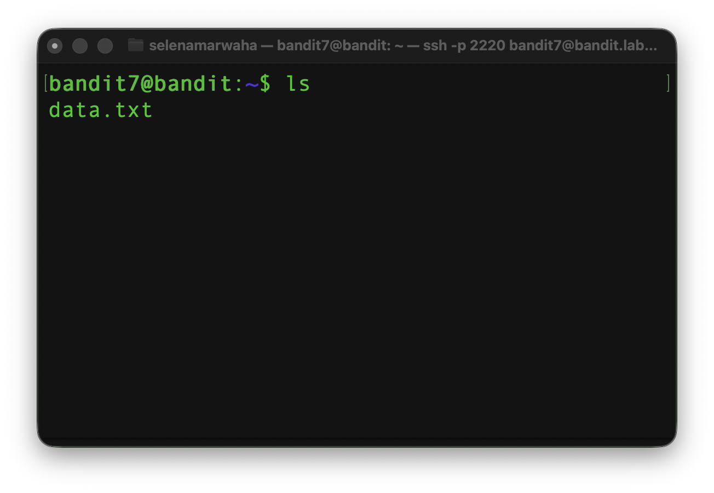
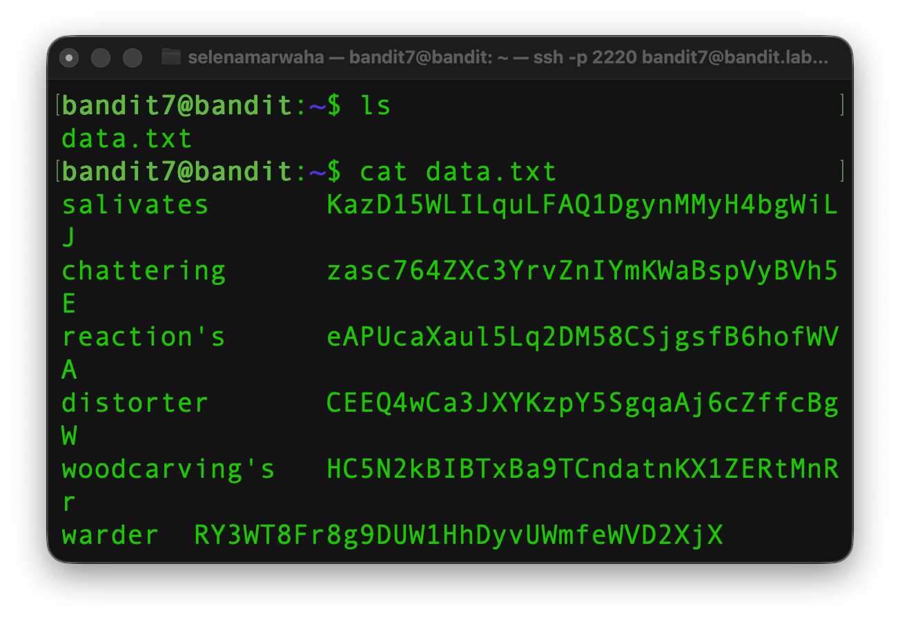
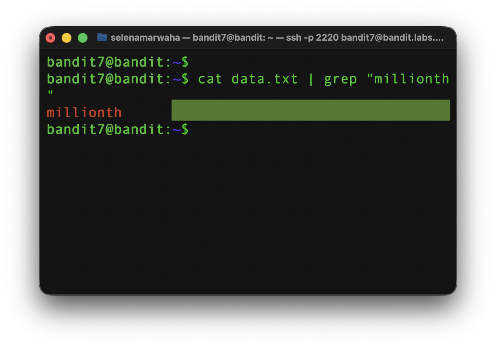

# OverTheWire Bandit 8
This is the solution to OverTheWire's Bandit Level 7→8. 

## Solution

The solution command is:
```bash
cat data.txt | grep "millionth"
``` 
## Instructions
This level asks:
> The password for the next level is stored in the file data.txt next to the word millionth

## Background
See `dictionary.md` for a full list of commands.

### `grep`

`grep` searches for content within files. It then prints out the matching lines.

<p align="center">
<code>
grep -i 'hello world' menu.h main.c
</code>
</p>

It has the following options:

| Option | Meaning | 
| ---- | ---- | 
| -i | Ignores the case | 
| -w | Matches whole words |
| -x | Matches whole lines |
| -v | Displays non-matching lines |


## Explanation
First, we have to access the game via `ssh`, where we paste the previous level's password. 

```bash
ssh bandit7@bandit.labs.overthewire.org -p 2220
```

Once we're in, we should view the contents of the directory using `ls`



Next, we view the contents of `data.txt`.



We can see that the file follows the format:
```
Word     random sequence of characters
```

This is an overwhelming amount of information to search through manually. Therefore, we must use `grep` to search for the word "millionth", since we know that the random sequence of characters next to it will be the password. As such, we use a pipeline to string together `cat data.txt` and `grep "millionth"`, opening the file and searching its contents, which gives us the password! 

