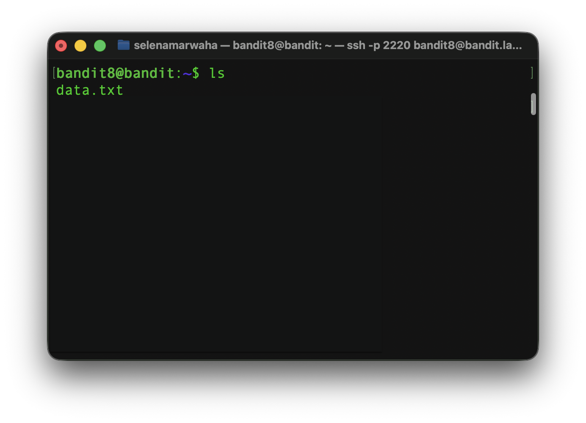
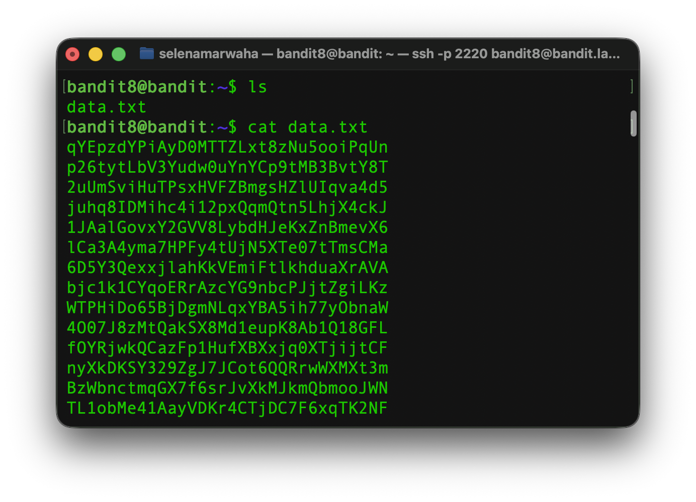
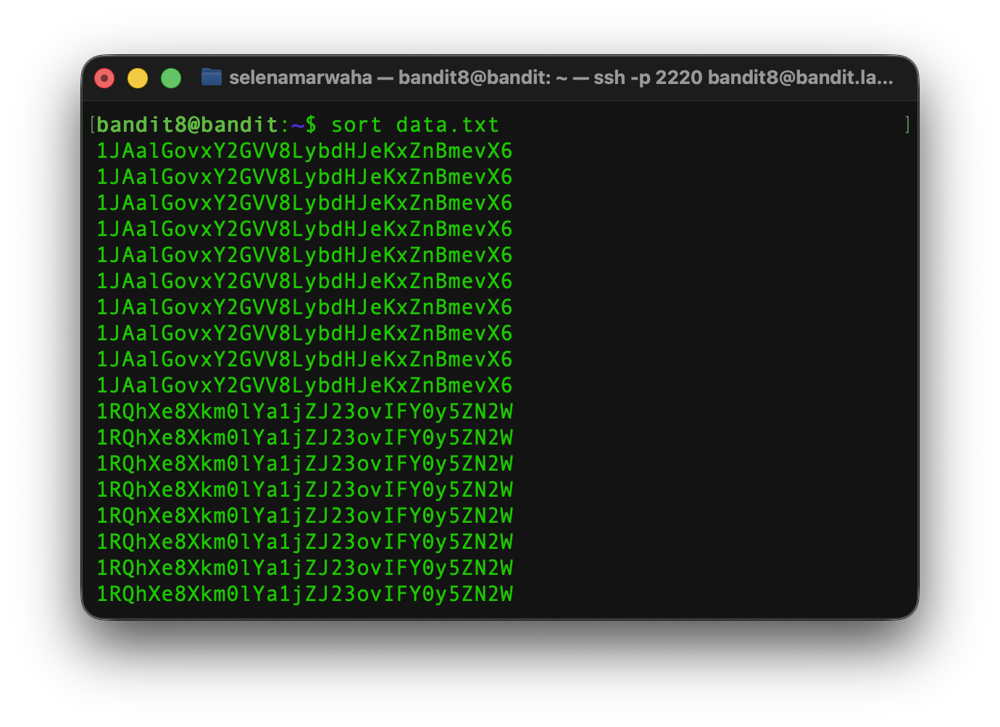
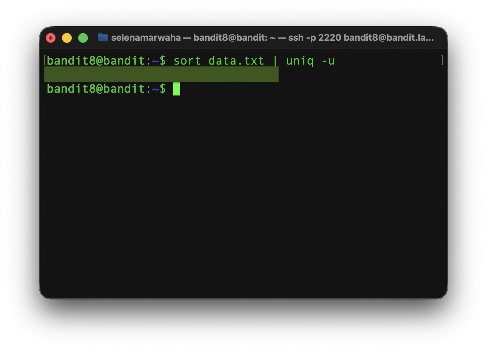

# OverTheWire Bandit 9
This is the solution to OverTheWire's Bandit Level 8→9. 

## Solution

The solution command is:
```bash
sort data.txt | uniq -u 
``` 
## Instructions
This level asks:
> The password for the next level is stored in the file data.txt and is the only line of text that occurs only once

## Background
See `dictionary.md` for a full list of commands.

### `sort`
The `sort` command **sorts** the contents of the file in alphabetical order. 

<p align="center">
<code>
sort file.txt
</code>
</p>

It has the following options:

| Option | Meaning | 
| ---- | ---- | 
| -f | Ignores the case | 
| -u | Only displays unique items |
| -n | Sorts based on numeric value |
| -R | Random sort|


### `uniq`
The `uniq` command smashes all duplicate adjacent lines into one. For example, 

```
hello
hello
hello
hi
```

becomes 

```
hello
hi
```

It is often used in conjunction with `sort` because the duplicate lines must be adjacent to collapse them. When you sort something, the duplicate lines will be next to each other, and a **pipeline** is used in between the commands.

<p align="center">
<code>
sort file.txt | uniq 
</code>
</p>

It has the following options:

| Option | Meaning | 
| ---- | ---- | 
| -f | Ignores the case | 
| -u | Only displays unique items |
| -n | Sorts based on numeric value |
| -R | Random sort|

### `pipelines`

In the previous subsection, a `|` character was used to separate the two commands. This is known as a **pipeline**. It makes the *output* of the first command the *input* to the second, and so on if there are more than two comands strung together. 

**For example,**

<p align="center">
<code>
ls /sandbox
</code>
</p>

returns `people.txt`, and the full command is 

<p align="center">
<code>
ls /sandbox | cat
</code>
</p>

the end result would be the contents of `people.txt`.


## Explanation
First, we have to access the game via `ssh`, where we paste the previous password.

```bash
ssh bandit8@bandit.labs.overthewire.org -p 2220
```
First, let's view the contents of the directory using `ls`.



Next, let's view the contents of `data.txt` using `cat data.txt`



Our goal is to find the only unique line. To remove duplicate lines, we use `uniq`, but this command has a requirement -- `uniq` needs the duplicate lines to be adjacent (next to each other). Therefore, we need to use `sort` to sort the file. 



As you can see, once we `sort` the file, duplicate entries are adjacent. This can be used in conjunction with `uniq` and a pipeline to remove these duplicates, as such: 


