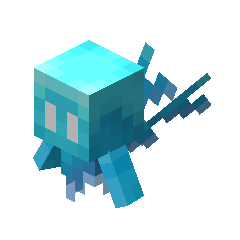

# OverTheWire Bandit Walkthrough

OverTheWire is a free online platform with several 'wargames' that are designed to teach cybersecurity basics.

[Bandit](https://overthewire.org/wargames/bandit) is targeted towards those learning linux basics.

This walkthrough, which is a work-in-progress, acts as an ongoing record of my learning and as my notes.

### Walkthroughs

Here is the full list of walkthroughs, last updated on 26.10.2026. The full dictionary of commands needed for this walkthrough is linked below.

[Command dictionary](./dictionary)

<b>
      
    <a href='./bandit0'>Level 0</a>.
</b> 
    <i>Using SSH.</i>

<b>
      
    <a href='./bandit1'>Level 0→1</a>.
</b> 
    <i>Opening files.</i>

<b>
      
    <a href='./bandit2'>Level 1→2</a>.
</b> 
    <i>Opening files with spaces.</i>

<b>
      
    <a href='./bandit3'>Level 2→3</a>.
</b> 
    <i>Opening files with special characters.</i>

<b>
      
    <a href='./bandit4'>Level 3→4</a>.
</b> 
    <i>Viewing hidden files.</i>

<b>
      
    <a href='./bandit5'>Level 4→5</a>.
</b> 
    <i>Human-readable files.</i>

<b>
      
    <a href='./bandit6'>Level 5→6</a>.
</b> 
    <i>Properties of files.</i>

<b>
      
    <a href='./bandit7'>Level 6→7</a>.
</b> 
    <i>Searching for files with <code>find</code>.</i>

<b>
      
    <a href='./bandit8'>Level 7→8</a>.
</b> 
    <i>Searching file contents using <code>grep</code>.</i>

<b>
      
    <a href='./bandit9'>Level 8→9</a>.
</b> 
    <i><code>sort</code> and <code>uniq</code>.</i>

<b>
      
    <a href='./bandit0'>Level 9→10</a>.
</b> 
    <i>Using <code>strings</code>.</i>

