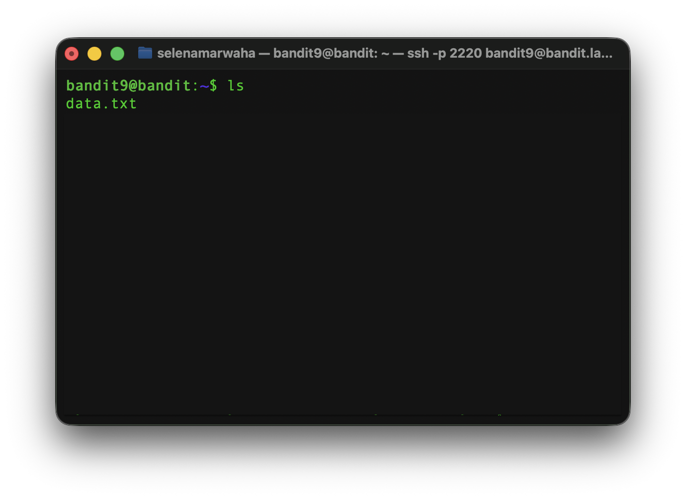
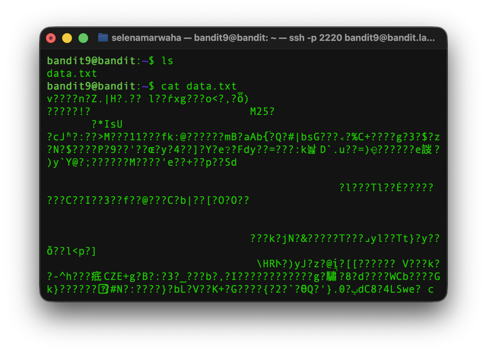
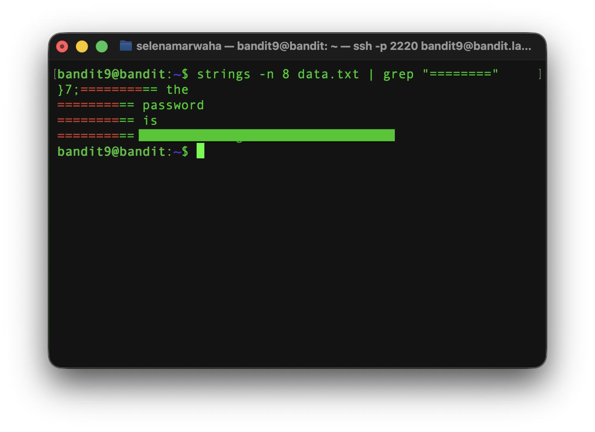

# OverTheWire Bandit 10 
This is the solution to OverTheWire's Bandit Level 9→10. 

## Solution

The solution command is:
```bash
strings -n 8 | grep "========" 
``` 
## Instructions
This level asks:
> The password for the next level is stored in the file data.txt in one of the few human-readable strings, preceded by several ‘=’ characters.

## Background
See <a href='./dictionary'>`dictionary.md`</a> for a full list of commands.

**Previous Commands:** `grep`

### `strings`
`strings` reads a file byte by byte and prints every run pf 4 or more printable characters in a row. It works on *any* file, even ones that `cat` can't show. Sometimes unreadable files contain messages, file paths, URLs and maybe passwords someone forgot to remove. It's safer than `cat` because it never runs the file.
<p align="center">
<code>
strings -n 8 mystery.bin
</code>
</p>

It has the following options:

| Option | Meaning | 
| ---- | ---- | 
| -n 8 | Only shows runs of 8 or more characters | 
| -t d | Shows where each string starts in the file | 
| -e l | Looks or 16-bit text (common in Windows programs) |

## Explanation
First, we have to access the game via `ssh`. 

```bash
ssh bandit9@bandit.labs.overthewire.org -p 2220
```

As always, let's view the contents of the dirctory using `ls`.



This shows us a file, `data.txt`. Let's view the contents of this file using `cat` to see if we can find the password. 



We can see that it looks like a whole bunch of gibberish. In other words, it's not human-readable. The task tells us, though, that we're looking for a human-readable string preceded by multiple `=` signs. 

This is where the `strings` command comes in. `strings`, as we said before, allows us to identify human-readable strings within unreadable files. If we use this, then search for the equal signs, we might be able to find our answer! 

We first identify the human-readable strings using `strings`. This displays human-readable strings littered throughout the file. To make our password easier to find, we then search the human-readable strings using `grep "========"` and a `pipeline`. 



And finally, we have the password!

<h2 style="text-align:center;"> ​✰ Navigation ​✰ </h2>
<table style="width: 100%;">
<tr>
<td style="text-align:left;"><a href='./bandit9'>
​​✰🇵​​🇷​​🇪​​🇻​​​✰</a></td>
<td style="text-align:center;"><a href='./README'>​✰​🇭​​🇴​​🇲​​🇪​✰​​</a></td>
<td style="text-align:right;"><a href='./404'>​✰​🇳​​🇪​​🇽​​🇹​✰​​</a></td>
</tr>

</table>