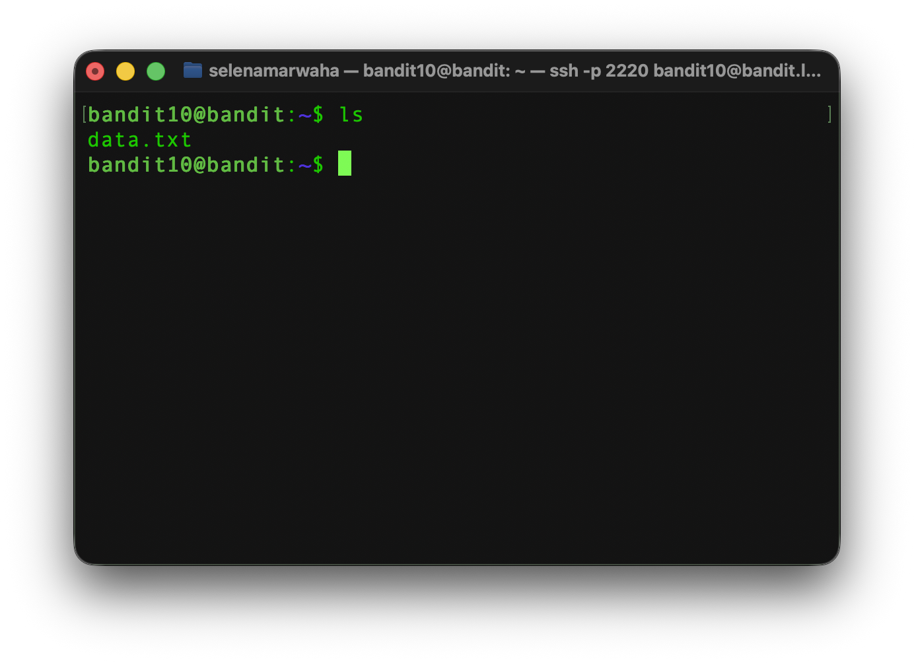
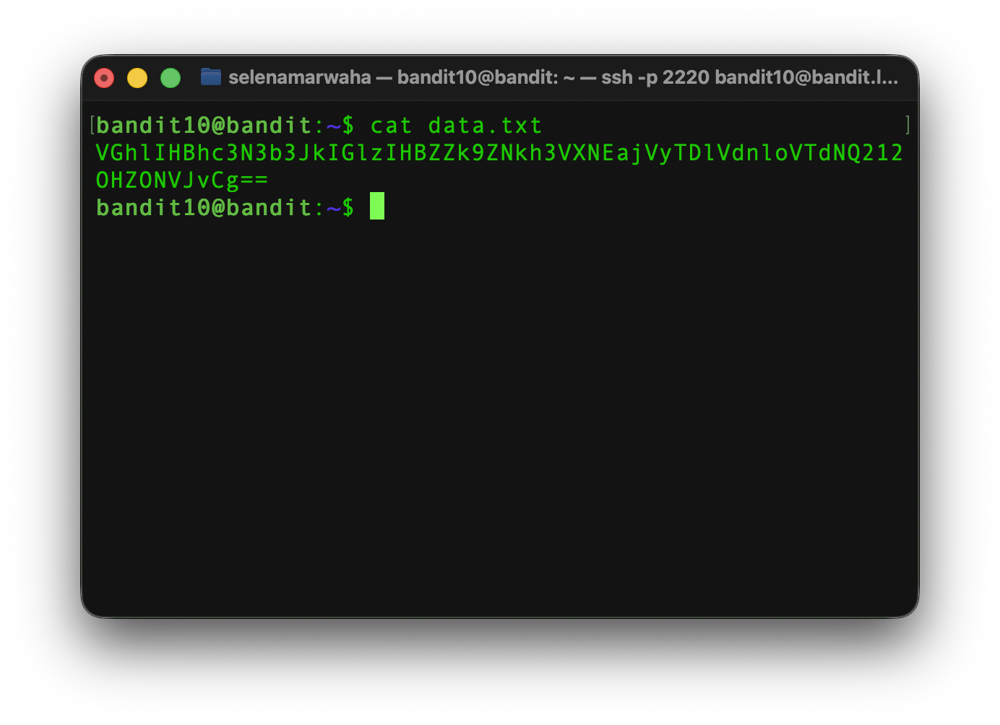
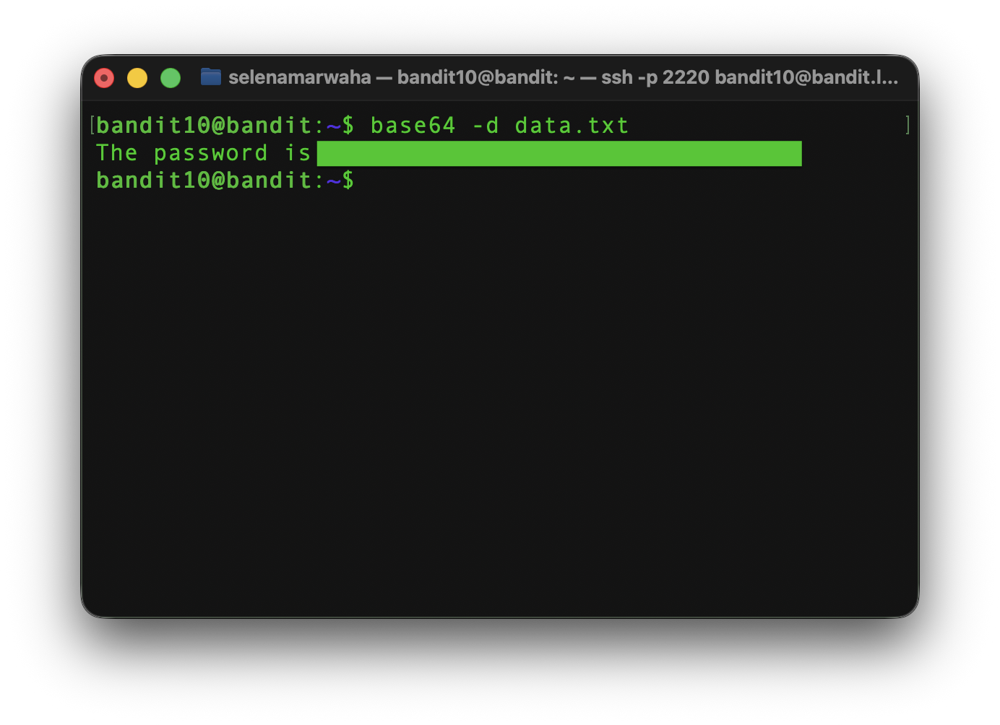

# OverTheWire Bandit 11
This is the solution to OverTheWire's Bandit Level 10→11. 

## Solution

The solution command is:
```bash
base64 -d data.txt
``` 
## Instructions
This level asks:
> The password for the next level is stored in the file data.txt, which contains base64 encoded data.

## Background
See <a href='./dictionary'>`dictionary.md`</a> for a full list of commands.

**Previous Commands:** `strings`, `grep`

### `base64`
Some systems were built for plain text *only*, like emails, URLs, and JSON. Raw `bytes` from an image, executable, or program can break them. `base64` encodes binary data using only **64** safe characters. The `base64` command, thus, encodes or decodes data to and from `base64` and `ASCII`. 

<p align="center">
<code>
base64 -d encoded.txt
</code>
</p>

A few things to note: 

1. **Default Behavior** <br> The default behavior for `base64` is to encode. By adding the `-d` option, you can have it decode.

2. **File Names** <br> `base64` accepts file names.

3. **Padding** <br> `base64` converts from ASCII in groups of 3 bytes (letters). For each missing byte (letter), we add one equal sign (=) to the end.

Here is the full set of characters within `base64`:

| Value | Characters |
| ---- | ---- |
| 0 → 25 | A → Z |
| 26 → 51 | a → z |
| 52 → 61 | 0 → 9 |
| 62, 63 | + and / |
| padding | = |
 

## Explanation
First, we have to access the game via `ssh`. 

```bash
ssh bandit10@bandit.labs.overthewire.org -p 2220
```

As always, let's view the contents of the directory using `ls`.



Once we look at the output of `data.txt`, we can see that the contents are **encoded**, therefore they mean nothing to us, as of now.



As stated in the level instructions, the text in `data.txt` is encoded using the `base64` encoding system, so we need to *decode* the contents of the file using `base64 -d`, which is the decode option. Once we run that command, we have the password!




<h2 style="text-align:center;"> ​✰ Navigation ​✰ </h2>
<table style="width: 100%;">
<tr>
<td style="text-align:left;"><a href='./bandit10'>
​​✰🇵​​🇷​​🇪​​🇻​​​✰</a></td>
<td style="text-align:center;"><a href='./index'>​✰​🇭​​🇴​​🇲​​🇪​✰​​</a></td>
<td style="text-align:right;"><a href='./404'>​✰​🇳​​🇪​​🇽​​🇹​✰​​</a></td>
</tr>

</table>