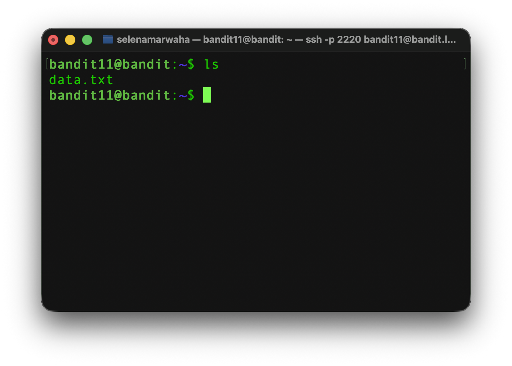
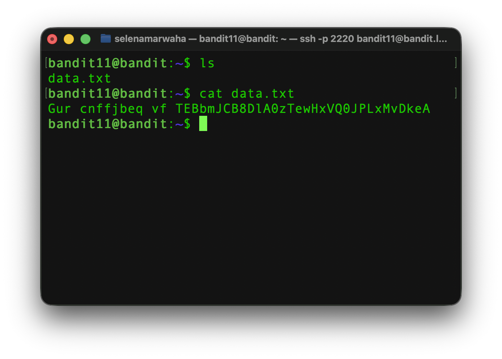
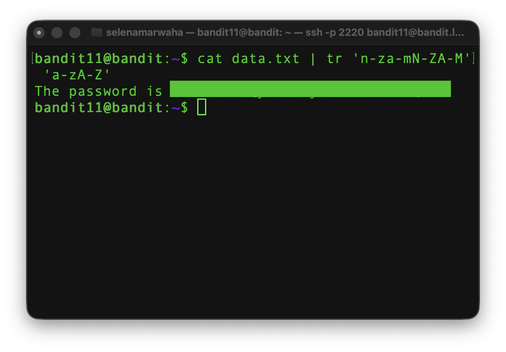

# OverTheWire Bandit 12
This is the solution to OverTheWire's Bandit Level 11→12. 

## Solution

The solution command is:
```bash
cat data.txt | tr 'n-za-mN-ZA-M' 'a-zA-Z'
``` 
## Instructions
This level asks:
> The password for the next level is stored in the file data.txt, where all lowercase (a-z) and uppercase (A-Z) letters have been rotated by 13 positions

## Background
See <a href='./dictionary'>`dictionary.md`</a> for a full list of commands.

**Previous Commands:** `base64`

### `tr`
`tr` stands for **translate**. When given two sets of letters, it swaps characters one for one. It reads text from standard input, so it **must** be used with a `pipeline` or `redirection`. `tr` works on single characters. It can't replace words.

<p align="center">
<code>
echo 'hello' | tr 'el' 'ip'
</code>
</p>

The above command would give us the string 'hippo'. This is because the 'e' would get swapped with an 'i', and the 2 'l's would get swapped with 'p's.

#### Ranges in `tr`:
A dash between 2 characters means everything from one to the other. For example, `a-z` would mean all of the characters from lowercase **a** to lowercase **z**. Ranges can also be chained, like this: `a-zA-Z` would be everything from a to z, then A to Z.


&nbsp;

---

&nbsp;

###  Caesar Cipher
A caesar cipher is a method of encryption which Julius Caesar famously used with his correspondents. It works by rotating the alphabet $n$ positions forward, where $n$ is an integer.

For example: 

| n | A | B | C | D | ... | Z |
| -- | -- |-- | -- | -- | -- | -- | 
| 1 | B | C | D | E | ... | A |
| 2 | C | D | E | F | ... | B |
| 3 | D | E | F | G | ... | C |
| ... |... |... | ... |... |... | ... |
| 13 | N | O | P | Q | ... | M |

The main weakness of the Caesar cipher is that it can be decoded very easily. You can very easily brute force a Caesar cipher because there are only 26 possibilities for the key.  

## Explanation
First, we have to access the game via `ssh`. 

```bash
ssh bandit11@bandit.labs.overthewire.org -p 2220
```

Let's list the contents of the directory using `ls`.



Next, let's look at the contents of `data.txt`. From previous levels' solutions, we know that the first part should be 'The password is'. What we have looks like a whole bunch of gibberish, so we know it's encrypted.



We need to rotate the text *back* 13 positions. So, let's replace the alphabet rotated 13 positions forward (`n-za-mN-ZA-M` in `tr` language) with the normal alphabet (`a-zA-Z`). Both uppercase and lowercase was included because the password will contain both uppercase and lowercase letters. If this step is not done, the password will be completely wrong.




And finally, we're in!


<h2 style="text-align:center;"> ​✰ Navigation ​✰ </h2>
<table style="width: 100%;">
<tr>
<td style="text-align:left;"><a href='./bandit11'>
​​✰🇵​​🇷​​🇪​​🇻​​​✰</a></td>
<td style="text-align:center;"><a href='./index'>​✰​🇭​​🇴​​🇲​​🇪​✰​​</a></td>
<td style="text-align:right;"><a href='./bandit404'>​✰​🇳​​🇪​​🇽​​🇹​✰​​</a></td>
</tr>

</table>